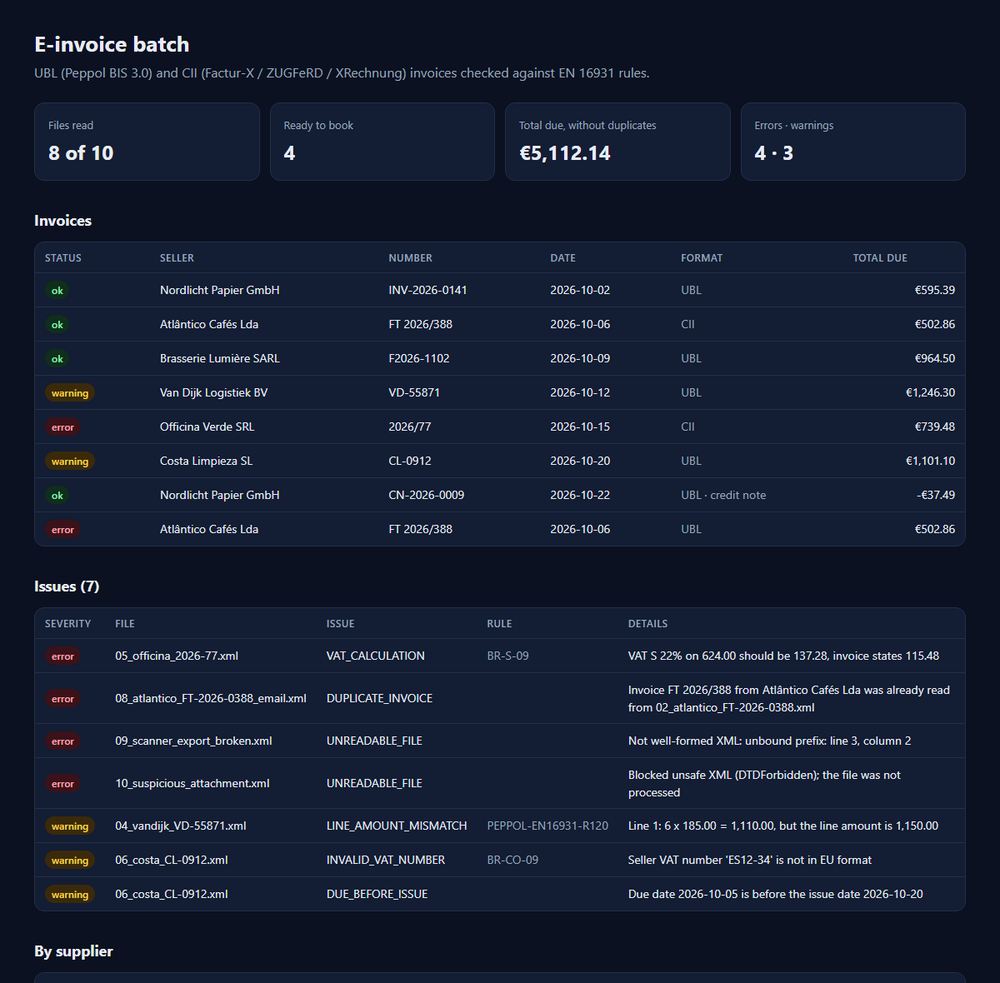

# E-invoice Reader

[](https://github.com/alelexand/einvoice-reader/actions/workflows/tests.yml)


Reads a folder of **European electronic invoices** in both main formats, **UBL** (Peppol BIS Billing 3.0) and **CII** (Factur-X, ZUGFeRD, XRechnung). It checks each one against the **EN 16931** business rules and exports the data to **Excel, SQLite and an HTML report**, ready for accounts payable.

E-invoicing is becoming mandatory across the EU (ViDA, Germany since 2025, Belgium and Poland in 2026, France from 2026). Companies are starting to receive XML instead of PDF, and someone has to turn those files into bookable data and catch the wrong ones before they are paid.



> All companies, VAT numbers and amounts are fictional and generated by `einvoice/sample.py`.

## What it does

- **Reads both syntaxes** into one model: header, seller and buyer with VAT numbers, lines, VAT breakdown and totals. Invoices and credit notes are both supported, and credit notes are reported as negative amounts.
- **Checks the arithmetic and mandatory fields** from EN 16931, each issue reported with the official rule id:

| Check | Rule |
|---|---|
| Mandatory fields: number, dates, currency, seller, buyer, totals, at least one line | BR-02…BR-16 |
| Lines add up to the stated line total | BR-CO-10 |
| Total without VAT = lines − allowances + charges | BR-CO-13 |
| VAT breakdown adds up to the total VAT | BR-CO-14 |
| Total with VAT = total without VAT + VAT | BR-CO-15 |
| Amount due = total with VAT − prepaid | BR-CO-16 |
| VAT per rate = base × rate | BR-S-09 |
| VAT base per rate = lines at that rate | BR-S-08 |
| Line amount = quantity × price | PEPPOL-EN16931-R120 |
| VAT numbers in EU format | BR-CO-09 |

- **Catches accounts payable problems** the standard doesn't: the **same invoice received twice** (even once as UBL and once as CII), due dates before the issue date, and files that aren't invoices at all. Duplicates are left out of the totals, so nothing gets paid twice.
- **Handles reverse charge** (category AE, 0%) for cross-border B2B invoices.
- **Parses safely.** Invoices come from outside the company, so XML is read with `defusedxml`. **XXE** and **"billion laughs"** payloads are blocked and reported instead of being processed. One of the sample files is exactly such an attack.

## Quick start

```bash
git clone https://github.com/alelexand/einvoice-reader.git
cd einvoice-reader
python -m venv .venv
# Windows: .venv\Scripts\activate   ·   macOS/Linux: source .venv/bin/activate
pip install -r requirements.txt

python -m einvoice read sample_invoices
```

```
  [OK  ] UBL Nordlicht Papier GmbH      INV-2026-0141        595.39 EUR
  [OK  ] CII Atlântico Cafés Lda        FT 2026/388          502.86 EUR
  [WARN] UBL Van Dijk Logistiek BV      VD-55871           1,246.30 EUR
  [ERR ] CII Officina Verde SRL         2026/77              739.48 EUR
  [OK  ] UBL Nordlicht Papier GmbH      CN-2026-0009         -37.49 EUR
  [ERR ] UBL Atlântico Cafés Lda        FT 2026/388          502.86 EUR
  [ERR ] 09_scanner_export_broken.xml (not processed)
  [ERR ] 10_suspicious_attachment.xml (not processed)

  8 invoice(s) read, 2 unreadable, 4 error(s), 3 warning(s)
```

`sample_invoices/` contains 10 files: domestic invoices from 5 countries with different VAT rates, a reverse-charge invoice, a credit note, and the problems planted on purpose (a wrong VAT calculation, a wrong line amount, an invalid VAT number, a duplicate, a broken file and an XXE attempt). Regenerate them with `python -m einvoice sample`.

## Usage

```bash
python -m einvoice read path/to/inbox another/folder single_invoice.xml \
    --out output --db finance.sqlite --strict
```

- **Excel** (`einvoices.xlsx`) has five sheets: *Invoices*, *Lines*, *VAT* (totals per category and rate), *Suppliers* and *Issues*.
- **SQLite** has the tables `invoices`, `invoice_lines`, `vat_breakdown` and `issues`. Re-running updates rows instead of duplicating them, so it can run on the same inbox every day.
- **HTML** (`einvoices.html`) is one self-contained page.
- `--strict` exits with code `1` when there are errors, for scheduled jobs.

Example query:

```sql
SELECT seller_name, ROUND(SUM(payable), 2) AS total
FROM invoices WHERE status != 'error' GROUP BY seller_name ORDER BY total DESC;
```

## Project structure

```
einvoice/
├── parse.py          # UBL + CII → one model, with defusedxml
├── model.py          # Invoice, Line, VatBreakdown (EN 16931 semantics)
├── validate.py       # business rules and duplicate detection
├── batch.py          # folder processing, supplier and VAT totals
├── store.py          # SQLite export (idempotent)
├── report_excel.py   # Excel export
├── report_html.py    # HTML report
├── sample.py         # fictional UBL and CII invoices
└── cli.py
tests/                # 30 tests (pytest)
```

## Scope

This covers the rules that catch the most common real-world errors. It is **not** a replacement for the official CEN/Peppol schematron validation, which a production pipeline should also run. Embedded Factur-X PDFs (XML inside a PDF) are not extracted yet. Pass the XML.

## License

MIT. Built by [Alexandre Lasse](https://alelexand.github.io), freelance developer of automation and custom software for SMEs. Getting e-invoices your team still types in by hand? [Get in touch](https://alelexand.github.io/#contact).
